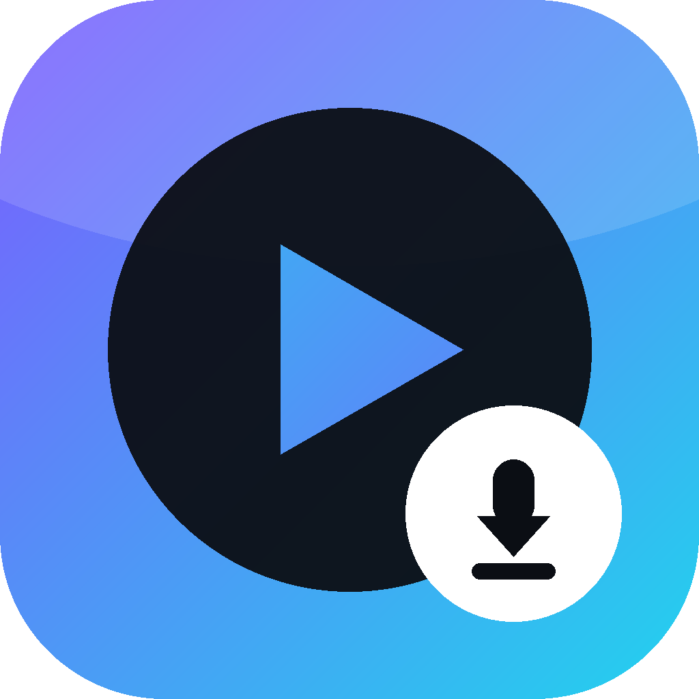
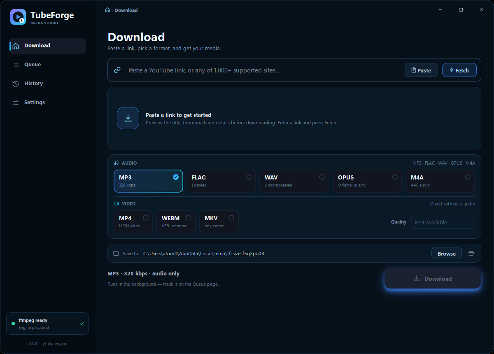
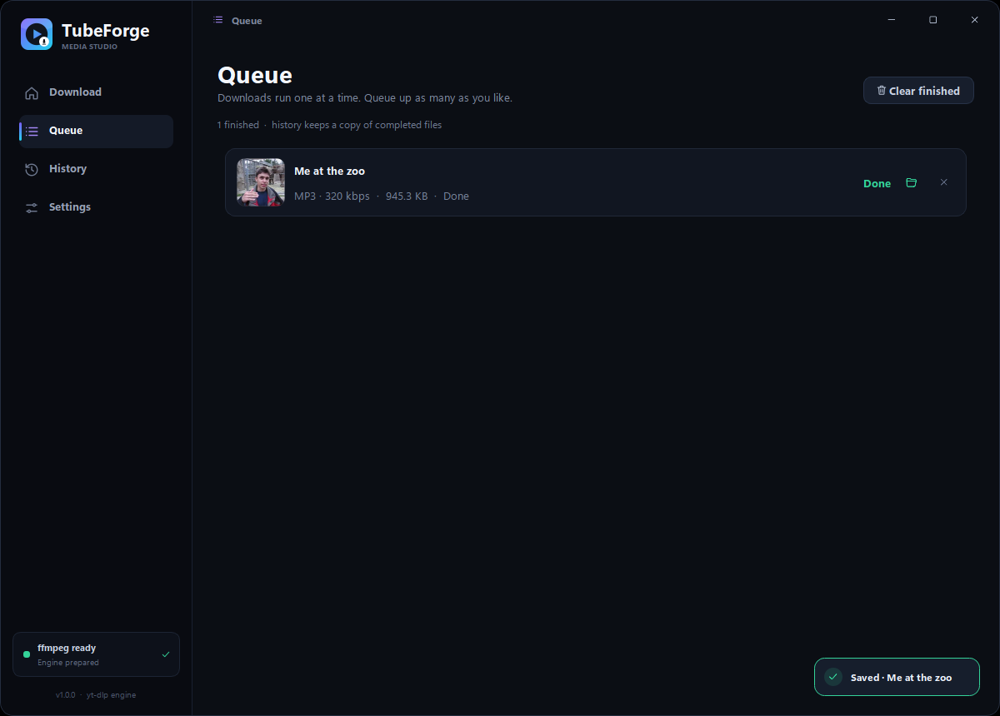
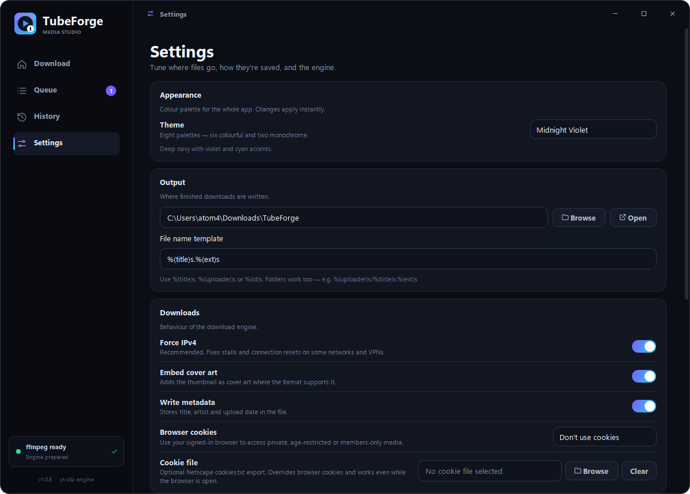
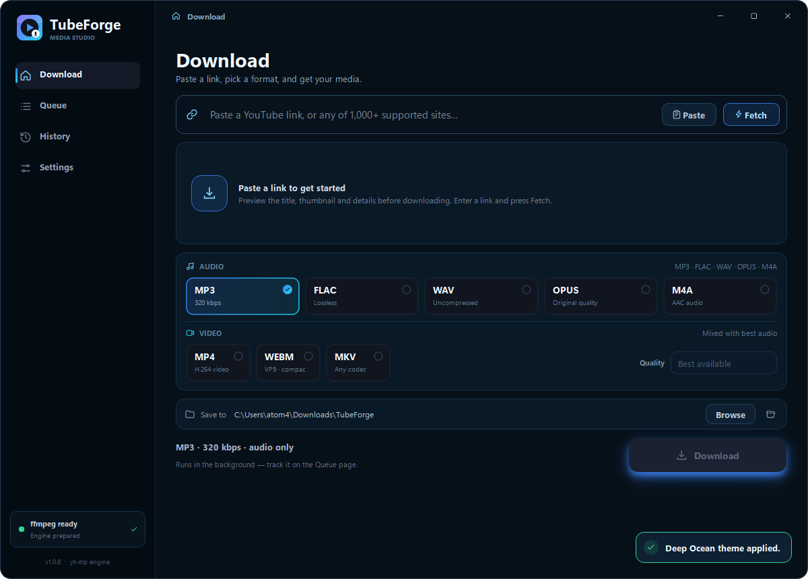

<div align="center">



<h1>TubeForge</h1>

<p><b>Media Studio — save YouTube (and 1,000+ other sites) as audio or video.</b></p>

<p>Two native editions that share one design language: a <b>Windows desktop app</b> built with
PySide6, and an <b>Android app</b> built with Kotlin.</p>

<p>
  
  
  
  
  
</p>

</div>

---

## Two editions, one app

| | **Desktop** | **Android** |
| --- | --- | --- |
| Platform | Windows 10 / 11, x64 | Android 10+ (API 29), arm64-v8a |
| Version | 1.0.8 | 1.0.1 |
| UI toolkit | PySide6 6.12 (Qt 6) | Kotlin + XML layouts, Material |
| Download engine | yt-dlp + ffmpeg (bundled) | `youtubedl-android` 0.17.4 — bundles CPython 3.11, yt-dlp, ffmpeg, ffprobe |
| Distribution | Per-user Inno Setup installer, 95 MB | Sideloaded APK, 42 MB |
| Installed size | ≈ 235 MB (ffmpeg included) | ≈ 75 MB after the first-run unpack |
| Output folder | Any folder you pick (default `Downloads\TubeForge`) | `Download/TubeForge` (shared storage, MediaStore) |
| Background work | In-app queue, window stays open | Foreground service + progress notification |

Same palettes, same sections (Download / Queue / History / Settings), same formats,
same one-at-a-time download model. The desktop build additionally has browser-cookie
import, drag-and-drop and ffmpeg auto-detection; the Android build adds a share-sheet
target and survives leaving the app.

## Screenshots

| | |
|:--:|:--:|
|  |  |
| <sub><b>Download</b> — fetch, preview, choose a format</sub> | <sub><b>Queue</b> — progress, speed and ETA</sub> |
|  |  |
| <sub><b>Settings</b> — output, downloads, engine</sub> | <sub><b>Themes</b> — Deep Ocean applied live</sub> |

> Desktop build shown. The Android app uses the same eight palettes and the same
> four sections, laid out for a phone with a bottom navigation bar.

## Download

Builds are attached to the repository's **Releases** page:

| Edition | File | Size |
| --- | --- | --- |
| Windows | `TubeForge-Setup-1.0.8.exe` | 95 MB |
| Android | `TubeForge-Android-1.0.1.apk` | 42 MB |

Neither build has a paid code-signing certificate, so Windows SmartScreen and Android
Play Protect may warn that the publisher is unknown. That is expected for self-built
software; both builds are safe to allow.

## Quick start

1. Paste a link — or on Android, share one into TubeForge from another app.
2. Press **Fetch** to preview the title, thumbnail, channel and duration.
3. Pick an audio or video format, optionally cap the resolution.
4. Press **Download** and watch it on the **Queue** page. Finished files appear in **History**.

## Formats

**Audio**

| Format | Details |
| --- | --- |
| MP3 | 320 kbps, plays everywhere |
| M4A | AAC audio, Apple-friendly |
| OPUS | keeps the original opus stream (no re-encode) |
| FLAC | lossless |
| WAV | uncompressed PCM |

**Video**

| Format | Details |
| --- | --- |
| MP4 | H.264 + AAC, maximum compatibility |
| WEBM | VP9 + Opus, smaller files |
| MKV | best available codecs, flexible container |

Video quality: **Best available**, then 2160p, 1440p, 1080p, 720p, 480p or 360p
(Android lists the heights the source actually offers, up to 2160p).

## Features

**Both editions**

- Fetched metadata preview — title, uploader, duration, thumbnail, source chip.
- Sequential queue with live percentage, speed and ETA; cancel queued or running jobs.
- Persistent **History** with an *Open* action for finished files.
- **Eight themes**, applied instantly and remembered: Midnight Violet, Aurora,
  Sunset Heat, Deep Ocean, Evergreen, Crimson, Graphite (mono), Sepia (mono).
- **Optional proxy** for region-locked media — `http://`, `https://` or `socks5://`,
  with optional user/password.
- **Cover art + metadata embedding** (toggleable).
- Bundled **ffmpeg** — no separate install, no PATH setup.
- Errors are cleaned up and shown inline: ANSI noise stripped, tracebacks trimmed to
  the useful lines.

**Desktop only**

- Frameless window with accent gradients, animated progress and toasts.
- **Retry** failed jobs; thumbnail cache; open file or containing folder from History.
- Browser cookies for age-restricted / private / members-only media — Chrome, Edge,
  Firefox, Brave, Opera, Vivaldi, or a Netscape `cookies.txt`. Chromium browsers are
  briefly closed, their cookie DB snapshotted, then reopened with your tabs.
- **Automatic bot-check handling** — retries with yt-dlp's browser impersonation
  (`curl_cffi`) when a site answers with a Cloudflare challenge.
- **Force IPv4** on by default — fixes IPv6 CDN connection stalls on some networks.
- ffmpeg auto-detection with one-click `winget` install or a manual path picker.
- Drag a link anywhere onto the window to start; custom output folder and file-name
  template (`%(title)s.%(ext)s`).

**Android only**

- **Share-sheet target** — share a YouTube link from any app and TubeForge prefetches it.
- **Foreground service** with a live progress notification, so downloads continue
  while the app is backgrounded or the screen is off.
- **Scoped-storage friendly output** — files land in `Download/TubeForge` through
  MediaStore and show up in the gallery / file manager. No storage permission
  required on Android 10+.
- **Plain-language error hints** mapped from engine output — private video, region
  block, bot check, HTTP 403, out of storage, connection timeout and so on.
- One-tap **Update yt-dlp** in Settings (fixes most engine breakages after site changes).

## Desktop (Windows)

### Install

Run `TubeForge-Setup-1.0.8.exe`. The installer:

- installs for the current user (**no administrator prompt**) into
  `%LOCALAPPDATA%\Programs\TubeForge`,
- bundles ffmpeg and ffprobe, so nothing else is needed,
- adds Start Menu and optional Desktop shortcuts,
- registers in **Settings → Apps**, where it can be uninstalled.

Uninstalling removes program files and shortcuts but keeps settings, history and
your downloaded media.

### Files and settings

| What | Where |
| --- | --- |
| Program | `%LOCALAPPDATA%\Programs\TubeForge` |
| Settings / history | `%APPDATA%\TubeForge` |
| Default downloads | `%USERPROFILE%\Downloads\TubeForge` |

### Build from source

```powershell
python -m pip install -r requirements.txt
python run.py
```

Python 3.10+ and Windows. Requires the 64-bit CPython build.

```powershell
.\build.ps1            # -> dist\TubeForge.exe  (PyInstaller)
.\build_installer.ps1  # -> dist\TubeForge-Setup-1.0.8.exe  (Inno Setup 6)
```

`build_installer.ps1` needs [Inno Setup 6](https://jrsoftware.org/isinfo.php) and the
ffmpeg binaries in `vendor\ffmpeg\bin`. The icon can be regenerated with
`python tools\make_icon.py`.

Diagnostics in a packaged build (JSON written to `%TEMP%`):

```powershell
.\dist\TubeForge.exe --check          # Qt / TLS / SVG / ffmpeg checks
.\dist\TubeForge.exe --download-test  # real MP3 download through the engine
.\dist\TubeForge.exe --ui-test        # window / themes / proxy-card smoke test
```

## Android

### Requirements

- Android **10 or newer** (API 29).
- **arm64-v8a** device (the norm for phones since around 2017). The APK is not built
  for x86 emulators or 32-bit devices.
- ≈ 80 MB free storage for the app plus whatever you download.

### Install

1. Copy `TubeForge-Android-1.0.1.apk` to the phone.
2. Allow "install unknown apps" for the app that opens it, then install.
3. On first launch the engine unpacks CPython and ffmpeg and installs yt-dlp — a few
   seconds of background work, once per install.
4. Grant the notification permission when asked (Android 13+); it powers the
   download progress notification.

Over USB with `adb`:

```bash
adb install -r TubeForge-Android-1.0.1.apk
```

### Storage

Finished files are published to **`Download/TubeForge`** through MediaStore, so they
are visible in the gallery, file managers and USB transfers without any storage
permission. Downloads are staged in the app cache and removed once published.

### Build from source

Requirements: **JDK 17**, Android SDK with platform/build-tools 35, Gradle 8.11.1.
Create `local.properties` with `sdk.dir=…` or set `ANDROID_HOME`.

```bash
# from the android/ folder
gradle assembleRelease
# -> app/build/outputs/apk/release/app-release.apk
```

Notes:

- `abiFilters = arm64-v8a`, `minSdk 29`, `targetSdk 35`.
- The release variant is signed with the local debug keystore so it sideloads without
  extra setup. Replace `signingConfig` in `app/build.gradle.kts` with your own keystore
  before publishing to a store.
- `extractNativeLibs=true` and `jniLibs.useLegacyPackaging=true` are **required**:
  the engine loads `libpython.zip.so` / `libffmpeg.zip.so` from `nativeLibraryDir`.

### Not ported to Android

Browser-cookie import, the ffmpeg path picker, drag-and-drop, custom title bar /
taskbar effects and the separate Windows installer are desktop-only by design.
Playlists behave the same on both editions: only the first item is used.

## Repository layout

This README works for a single repository holding both editions:

```
README.md            this file
docs/                screenshots used above
desktop/             PySide6 app (run.py, app/, installer/, tools/)
android/             Kotlin app (app/, tools/, gradle files)
```

If you keep two repositories instead, copy this README into each one, keep the
`docs/` folder next to it, and link the other repository from the header.

## Troubleshooting

| Symptom | Fix |
| --- | --- |
| *"Sign in to confirm you're not a bot"* | Desktop retries with impersonation automatically; if it still fails, set **Settings → Downloads → Browser cookies** to the browser you're signed in to. On Android, press **Update yt-dlp** first. |
| *"Video not available in your country"* | Set a proxy in **Settings → Proxy**. |
| Download fails out of nowhere | Site extractors change constantly — update yt-dlp (Android: **Settings → Update**; desktop: reinstall the latest build). |
| Desktop says ffmpeg is missing | **Settings → Tools → Install with winget**, or **Locate** `ffmpeg.exe`. |
| Android downloads stall in the background | Allow notifications for TubeForge so the progress notification stays visible — some OEM builds are aggressive about stopping services whose notification is hidden. Also exclude TubeForge from battery optimisation. |
| Files "not showing up" on Android | They are in `Download/TubeForge`. Some gallery apps need a refresh; a file manager will see them immediately. |

## Credits and licence

- Download engine: [yt-dlp](https://github.com/yt-dlp/yt-dlp) (Unlicense).
- Android engine: [youtubedl-android](https://github.com/JunkFood02/youtubedl-android)
  by JunkFood02 and contributors (**GPL-3.0**), bundling CPython, yt-dlp and ffmpeg.
- Media conversion: [ffmpeg](https://ffmpeg.org/) — see the bundled build for its licence.
- Desktop UI: [Qt for Python / PySide6](https://doc.qt.io/qtforpython-6/) (LGPLv3).
- Browser impersonation: [curl_cffi](https://github.com/lexiforest/curl_cffi) (MIT).
- Tags and cover art: [mutagen](https://mutagen.readthedocs.io/) (GPL-2.0+).
- Android UI: AndroidX + Material Components (Apache-2.0).

TubeForge's own code is distributed under the **GPL-3.0**, because the Android build
links a GPL-3.0 engine. If you publish binaries, keep the source available. Include
the full license text in a `LICENSE` file when you publish the repository.

**TubeForge is not affiliated with YouTube, Google, or any site it can download from.**
Only save content you have the right to keep.
